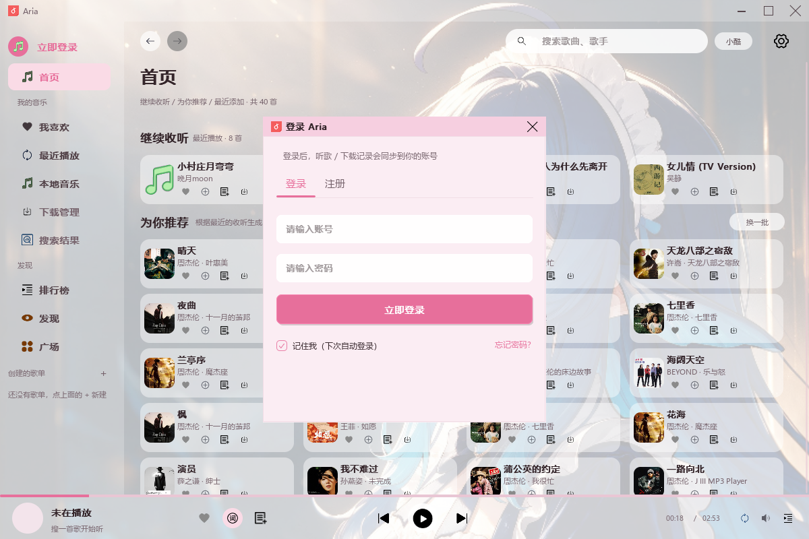

# 案例：Aria —— 桌面音乐客户端



> 本机实际运行截图（`dist/aria.exe`）。

> 本地仓库：`D:\CLeno\Aria`（79 个 `.leno` / 27,475 行 / 646 张图片资源）

## 它是什么

一个桌面音乐客户端：播放器内核、歌词页、多音源搜索、缓存与封面管理，界面用 `LenoSDL3` 画。

## 规模

| 项 | 数值 |
|---|---|
| `.leno` 文件 | **79** |
| 代码行 | **27,475** |
| 最大文件 | `player_tick.leno` 3,292 行、`player_core.leno` 2,869 行、`page_lyric.leno` 1,118 行 |
| 入口 | `aria.leno`（53 行，拉起各页与内核） |
| 依赖（`leno.toml`） | `LenoSDL3 >=0.1.1`、`LenoWeb >=1.0.0`、`LenoSys >=0.1.0`、`LenoCrypto >=1.1.0`、`LenoHTTP >=0.2.9`、`LenoMusic >=2.0.0` |

## 用到的模块（按出现次数）

```
dirs×41  files×37  strings×35  SDL3×30  WebNet×20
jsons×18  times×18  threads×18  Sys×16  HTTP×10  Music×9
```

一句话：**文件 + 网络 + 线程 + 界面 + 系统 API** 全用上了，没有"这活干不了得换语言"的缺口。

## 结构

```
Aria/
├── aria.leno          ← 入口
├── lib/               ← 播放内核、页面、组件（大头）
├── server/            ← 附带的小服务（server.leno）
├── tools/             ← 生成封面、压测等脚本
├── test/              ← 断言
└── images/            ← 界面素材与封面
```

## 怎么跑

需要有 LenoLang 运行时（编译器/VM），然后在项目目录：

```bat
leno aria.leno
```

## 打包

```bat
leno -p --no-console -o=dist aria.leno
```

产出的 `dist\aria.exe` 可以直接发给没装 Leno 的机器（首次运行会自动把依赖解包到缓存目录）。

## 值得借鉴的几点

- **把"播放"拆成 `player_core` + `player_tick`**：核心状态与每帧推进分开，测试好写。
- **页面即文件**（`page_lyric.leno`）：一个界面一个文件，改界面不用在几千行里找。
- **`threads×18`**：下载/解码/抓取都不阻塞界面线程。
