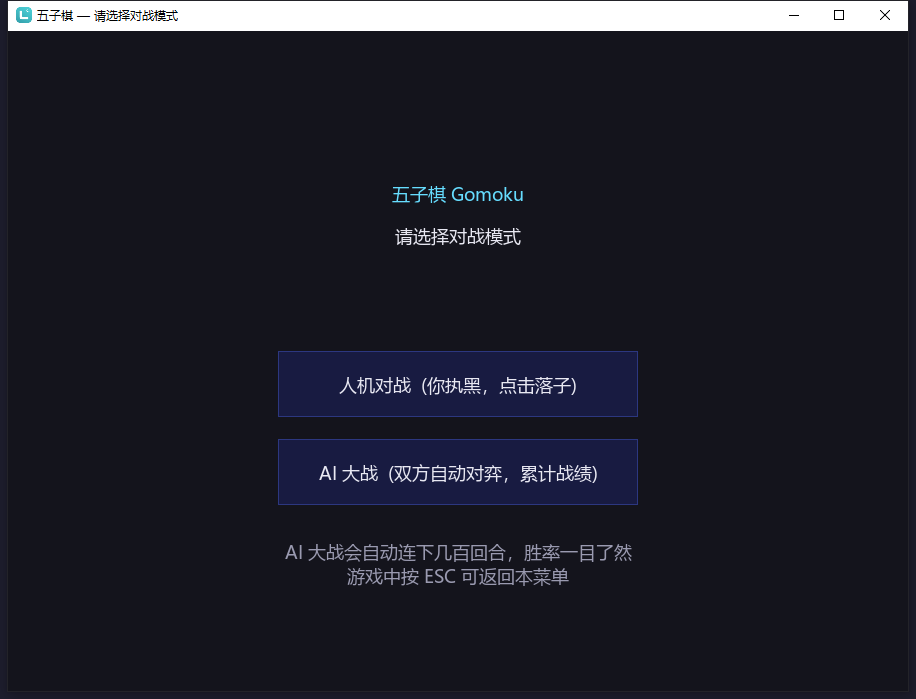

# 案例：LenoGame —— 9 个用 Leno 写的图形小游戏



> 本机实际运行截图：`leno.exe gomoku.leno` 起的五子棋对战菜单。

> 本地仓库：`D:\CLeno\LenoGame`（25 个 `.leno` / 21,217 行 / 1,971 张素材图）

## 它是什么

九个完整的小游戏/动画，全部 `LenoSDL3` 绘制：

| 目录 | 主文件 |
|---|---|
| `植物大战僵尸/`、`植物大战僵尸测试版/` | `pvz2.leno`（3,951 行）、`pvz.leno`（1,547 行）+ 地图/动画编辑器 `anim_editor.leno`（1,891 行） |
| `塔防/` | `tower_defense.leno`（2,582 行） |
| `超级玛丽/`、`飞机大战/`、`俄罗斯方块/`、`五子棋/`、`扫雷/` | 各自独立 |
| `鹈鹕动画/` | 纯动画演示 |

## 规模

| 项 | 数值 |
|---|---|
| `.leno` 文件 | **25** |
| 代码行 | **21,217** |
| 素材 | **1,971** 张（精灵、地图、动画帧） |

## 用到的模块

```
SDL3×21  dirs×12  Music×11  rands×8  maths×7
files×5  （另有各自项目的 *_types / *_util 模块）
```

## 怎么跑

```bat
leno 五子棋\gomoku.leno
```

只做编译检查、不运行：

```bat
leno -c 五子棋\gomoku.leno
```

## 值得借鉴的几点

- **游戏逻辑和素材分开**：`*_types.leno` / `*_util.leno` 放数据结构与工具，主文件只写循环与规则。
- **`anim_editor.leno`（1,891 行）**：用 Leno 写了个**编辑器**给游戏做地图和动画——工具链自举不只发生在文档站。
- 没有打包成 exe 的硬需求时，直接 `leno xxx.leno` 迭代最快。
