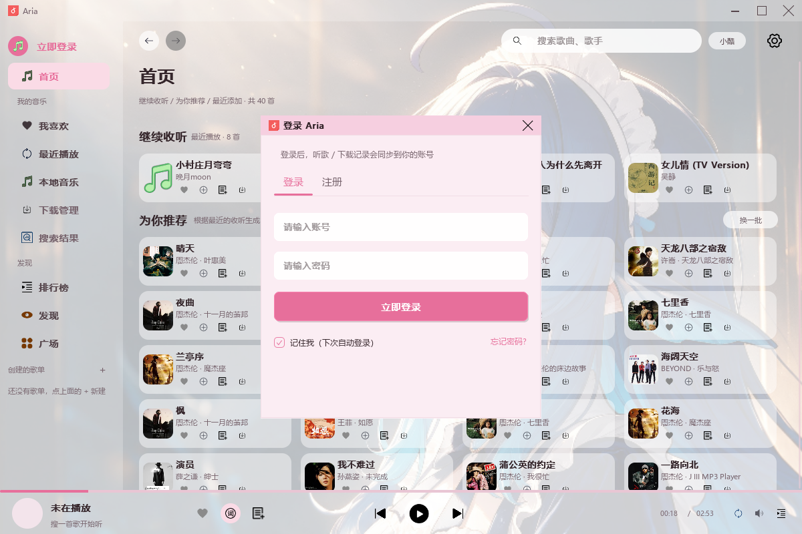

# 真实项目案例（Leno 都用来做了什么）

> 这一组页面不是教程，而是**用 Leno 真写出来的项目**：代码量、用到的模块、怎么跑、怎么打包。
> 数字都来自对仓库的实际扫描（`.leno` 文件数与行数、`import` 统计）。

> 下面的截图**都是本机实际运行项目后拍的**（Aria / LenoMusic / LenoGame / LenoCleaner / LenoTrae / LenoWorkBuddy）；涉及账号的已打码，LenoDumate 那张来自项目仓库并在页内注明。

| 项目 | 一句话 | 规模 | 类型 |
|---|---|---|---|
| [Aria](Aria.md) | 桌面音乐客户端（播放器 + 歌词 + 多音源） | 79 文件 / 27.5k 行 | 桌面应用 |
| [LenoMusic](LenoMusic.md) | 多音源音乐搜索 + 边下边播 + 下载工具 | 46 文件 / 16.4k 行 | 桌面应用 |
| [LenoGame](LenoGame.md) | 9 个用 Leno 写的图形小游戏 | 25 文件 / 21.2k 行 | 游戏 |
| [LenoCleaner](LenoCleaner.md) | C 盘清理（扫描规则 + 图形界面） | 11 文件 / 4.5k 行 | 系统工具 |
| [LenoTrae](LenoTrae.md) | Trae 每日自动签到（托盘 GUI + 定时） | 12 文件 / 3.5k 行 | 自动化 |
| [LenoWorkBuddy](LenoWorkBuddy.md) | WorkBuddy 自动签到 + 成长中心 | 16 文件 / 5.3k 行 | 自动化 |
| [LenoDumate](LenoDumate.md) | 百度搭子签到（AES-256-GCM 解 cookies） | 7 文件 / 2.0k 行 | 自动化 |
| [AriaDeployd](AriaDeployd.md) | 目标机部署守护进程（内网 HTTP + 进程管理） | 2 文件 / 0.8k 行 | 运维工具 |

## 这些案例说明了什么

1. **GUI 是主力**：8 个项目里 5 个是 SDL3 图形界面，而不是"顺便能画个窗口"。
2. **单文件交付真的被用了**：`leno -p -o=dist xxx.leno` 出来的 exe 直接发给别人，目标机不用装 Leno。
3. **要碰系统/协议的时候不绕路**：注册表与磁盘扫描（Cleaner）、AES-256-GCM 解 cookies（Dumate）、内网 HTTP + 起停进程（Deployd）、多音源抓取（Music/Aria）。
4. **测试是一等公民**：好几个项目里 `test_*.leno` 占了三到四成代码量。

